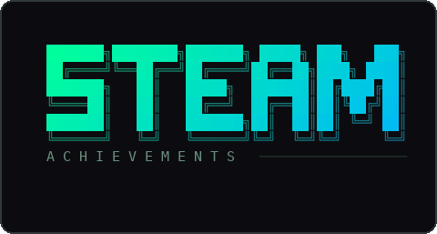
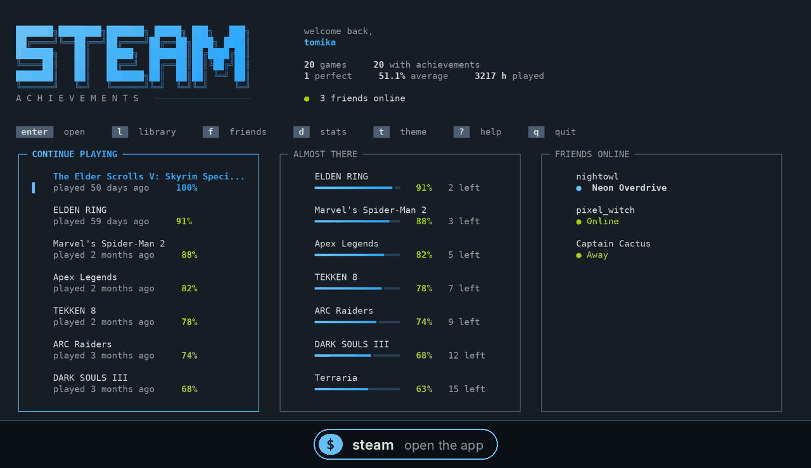
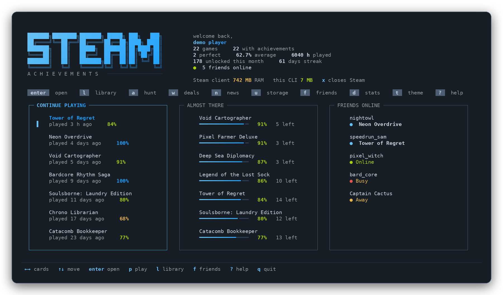
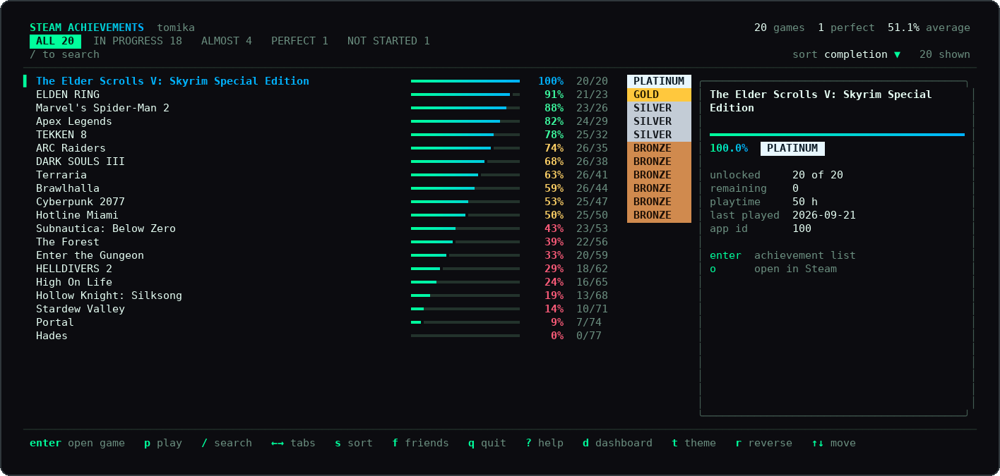
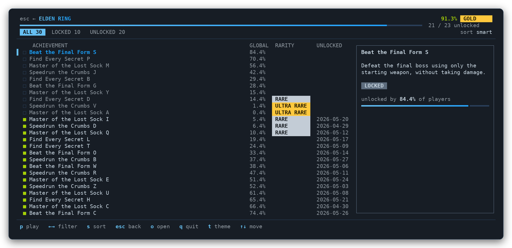
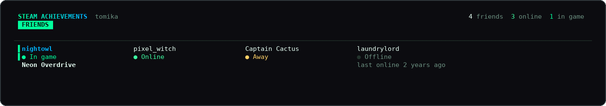

<p align="center">
  
</p>

<p align="center">
  <a href="https://github.com/tomikav/steam-achievements-cli-/releases/latest"></a>
  <a href="https://github.com/tomikav/steam-achievements-cli-/actions/workflows/ci.yml"></a>
  
  <a href="LICENSE"></a>
</p>

<p align="center">
  <a href="#install"><b>Install</b></a> &nbsp;&middot;&nbsp;
  <a href="#set-up-in-3-steps"><b>Set up</b></a> &nbsp;&middot;&nbsp;
  <a href="#what-you-get">What you get</a> &nbsp;&middot;&nbsp;
  <a href="#keys">Keys</a> &nbsp;&middot;&nbsp;
  <a href="#something-not-working">Help</a>
</p>

<br>

<p align="center">
  
</p>

<br>

**steam** is a terminal app for your Steam library. See how close you are to
100% in every game, browse achievements with their real icons and rarity,
check which friends are online and what they are playing, and launch or close
games with one key. Steam can stay in the background the whole time.

<br>

## Install

<table>
<tr>
<td width="50%" valign="top">

**Windows** &nbsp;(PowerShell)

```powershell
irm https://raw.githubusercontent.com/tomikav/steam-achievements-cli-/main/install.ps1 | iex
```

</td>
<td width="50%" valign="top">

**macOS / Linux**

```bash
curl -fsSL https://raw.githubusercontent.com/tomikav/steam-achievements-cli-/main/install.sh | sh
```

</td>
</tr>
</table>

That is it: the script downloads the latest release, verifies its checksum and
adds `steam` to your PATH. No admin rights. Open a new terminal afterwards.

<details>
<summary>Other ways to install</summary>

<br>

With Go 1.26+:

```bash
go install github.com/tomikav/steam-achievements-cli-/cmd/steam@latest
```

Or download a zip from [Releases](https://github.com/tomikav/steam-achievements-cli-/releases/latest)
and put the binary anywhere on your PATH.

On Linux the installer names the command `steam-ach` so it does not clash with
the Steam client. Set `BIN_NAME=steam` before running it to change that.

</details>

<br>

## Set up in 3 steps

**1 &nbsp;Get a free API key** at [steamcommunity.com/dev/apikey](https://steamcommunity.com/dev/apikey).
Any domain works in the form, `localhost` is fine.

**2 &nbsp;Save it with your Steam ID** (the 17-digit number from [steamid.io](https://steamid.io),
or your custom profile name):

```bash
steam config set key YOUR_API_KEY
steam config set id  YOUR_STEAM_ID
```

**3 &nbsp;Make your game details public** in
[Steam › Edit Profile › Privacy Settings](https://steamcommunity.com/my/edit/settings):

| Setting | Set to | Needed for |
|:--|:--|:--|
| My profile | **Public** | everything |
| Game details | **Public** | your games and achievements |
| Friends List | **Public** | the friends view (optional) |

> "Friends only" is not enough. The API key does not sign in as you, so Steam
> treats it like a visitor. Changes can take a few minutes to apply.

Then check and go:

```bash
steam doctor   # tells you if anything is missing
steam          # opens the app
```

<br>

## What you get

### Home

Your library at a glance: what you played last, the games closest to 100%,
and friends online with the game they are in. Press `enter` on anything to
open it, `p` to jump straight into a game.

<p align="center"></p>

### Game view

Everything about one game: store description, developer, genres, Metacritic
score, install size, your progress and the full achievement list. Unlocked
achievements show in colour, framed in gold when fewer than 5% of players have
them; locked ones are greyed out. Pick one to read its description and when
you unlocked it.

**Play from here.** `p` launches the game, `c` twice closes it. While it runs,
a session clock ticks and achievements refresh every 45 seconds, so new
unlocks pop up as they happen.

<p align="center"></p>

<table>
<tr>
<td width="50%" valign="top">

**Library**<br>
Every game you own, with or without achievements. Tabs for in progress,
almost there, perfect and not started. Live search with `/`.



</td>
<td width="50%" valign="top">

**Achievements**<br>
The full list: locked ones easiest first, unlocked ones rarest first,
with global unlock rates and rarity labels.



</td>
</tr>
<tr>
<td width="50%" valign="top">

**Friends**<br>
Who is online, who is away and what everyone is playing. `enter` opens
their profile.



</td>
<td width="50%" valign="top">

**Stats**<br>
Totals, average completion, a chart of your library by completion and the
games you are closest to finishing.


</td>
</tr>
</table>

### Steam stays in the background

The app reads everything from Steam's web API, so the Steam window never has
to be open. When you launch a game on Windows or Linux, Steam is started hidden in the tray if it
is not running yet, and the game opens directly.

### Icons in your terminal

Game icons, achievement icons, avatars and header art are drawn as real images
in terminals that support them: **Windows Terminal 1.22+**, WezTerm, iTerm2
3.5+, foot. In other terminals everything works, just without pictures.

### Themes

`steam` (default, Steam's own blue and grey) &nbsp;·&nbsp; `hacker` &nbsp;·&nbsp; `gamer` &nbsp;·&nbsp;
`synthwave` &nbsp;·&nbsp; `sunset` &nbsp;·&nbsp; `frost` &nbsp;·&nbsp; `mono`

Press `t` inside the app to cycle through them, or keep one:

```bash
steam config set theme synthwave
```

<br>

## Keys

| Key | Home / Library | Game view |
|:--:|:--|:--|
| `↑` `↓` `←` `→` | move, switch cards or tabs | browse achievements, filter |
| `enter` | open | full-screen achievement list |
| `p` | open game and play | launch the game |
| `c` `c` | | close the game |
| `/` | search the library | |
| `s` &nbsp;`r` | sort, reverse | sort |
| `l` &nbsp;`f` &nbsp;`d` | library, friends, stats | |
| `o` | achievement page in browser | store page |
| `t` | change theme | change theme |
| `?` | every key | every key |
| `esc` &nbsp;`q` | back, quit | back, quit |

Mouse wheel and clicks work too.

<br>

## For scripts

Every view has a plain command, and `--format json` or `--format plain` for
piping:

```bash
steam list --min 90                   # games at 90% or more
steam list --sort playtime --top 10   # where your hours went
steam perfect                         # only 100% games
steam game "elden ring"               # one game's checklist
steam stats                           # library dashboard
steam list --format json | jq '.[0]'
```

Add `--demo` to any command to try it with made-up data, no account needed.

<br>

## Something not working?

Run `steam doctor` first. It checks your key, your Steam ID and every privacy
setting, and tells you exactly what to change.

| You see | Do this |
|:--|:--|
| `Steam rejected your API key` | Create a new key and run `steam config set key ...`. A `STEAM_API_KEY` environment variable overrides the saved key. |
| `Your game details are private` | Set Game details to Public (step 3) and wait a few minutes. |
| `your friends list is private` | Set Friends List to Public, then press `R` in the friends view. |
| One game skipped with HTTP 500 | Steam fails for that game; it is retried the next day. |
| No pictures | Your terminal has no image support. Press `i` to hide the empty space. |

<br>

## Privacy

Read-only: the app never changes anything on your account. Your key is stored
in a file only your user can read and is sent only to Steam. Results are
cached on your machine so later runs open instantly. No telemetry.

<br>

## Build from source

```bash
git clone https://github.com/tomikav/steam-achievements-cli-.git
cd steam-achievements-cli-
go build -o steam ./cmd/steam
go test ./...
```

<br>

<p align="center">
  <sub>MIT licensed &nbsp;·&nbsp; not affiliated with Valve or Steam</sub>
</p>
<!-- docs: minor edit -->
<!-- docs: pass 2 -->

Colors follow your terminal theme; use `--theme steam` to force the Steam palette.

See also: `steam-achievements --help` for the full flag list.

See also: `steam-achievements --help` for the full flag list.
