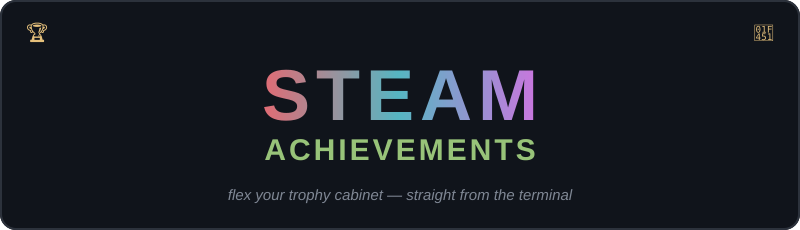
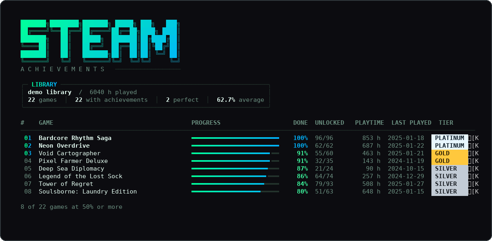
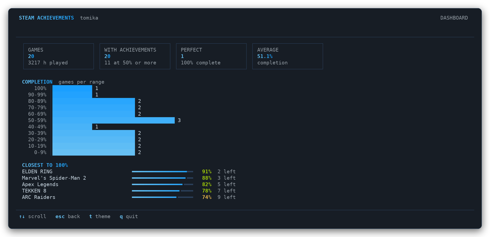
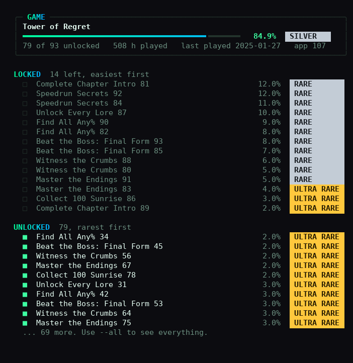

<div align="center">



**A fast, read-only terminal client for your Steam achievement progress.**

[](https://github.com/tomikav/steam-achievements-cli-/actions/workflows/ci.yml)
[](https://github.com/tomikav/steam-achievements-cli-/releases/latest)
[](https://go.dev)
[](https://github.com/tomikav/steam-achievements-cli-/releases/latest)
[](LICENSE)

</div>

---

`steam` reads your library through the official Steam Web API and shows, in one
table, how close you are to completing every game you own: what is almost done,
what is far off, and where your playtime went.

<p align="center"></p>

- Gradient progress bars, tier medals (platinum, gold, silver, bronze) and four colour themes
- Fast: skips games without achievements, reuses connections, and caches results until you play a game again
- Single static binary, no runtime dependencies
- Read-only: it never changes anything on your account
- Your API key stays on your machine and is only sent to `api.steampowered.com`
- Script-friendly `plain` and `json` output
- Built-in `steam doctor` that pinpoints credential and privacy problems

## Contents

- [Install](#install)
- [Quick start](#quick-start)
- [Requirements: public game details](#requirements-public-game-details)
- [Usage](#usage)
- [Configuration](#configuration)
- [Troubleshooting](#troubleshooting)
- [Security and privacy](#security-and-privacy)
- [Building from source](#building-from-source)
- [Contributing](#contributing)

## Install

### Windows

```powershell
irm https://raw.githubusercontent.com/tomikav/steam-achievements-cli-/main/install.ps1 | iex
```

Installs `steam.exe` to `%LOCALAPPDATA%\Programs\steam-achievements-cli` and adds
it to your user `PATH`. No administrator rights required. Open a new terminal
afterwards.

### macOS and Linux

```bash
curl -fsSL https://raw.githubusercontent.com/tomikav/steam-achievements-cli-/main/install.sh | sh
```

Installs to `~/.local/bin`. On Linux the binary is named `steam-ach` so it does
not shadow the Steam client's own `steam` command; set `BIN_NAME=steam` to
override.

Both installers download the latest release from GitHub and verify its SHA-256
checksum before installing. Pin a version with `STEAM_CLI_VERSION=v1.1.0`.
Prefer to read a script before running it? Both are short:
[install.ps1](install.ps1), [install.sh](install.sh).

### With Go

```bash
go install github.com/tomikav/steam-achievements-cli-/cmd/steam@latest
```

### Manual

Download the archive for your platform from the
[releases page](https://github.com/tomikav/steam-achievements-cli-/releases/latest),
check it against `checksums.txt`, and put the binary anywhere on your `PATH`.

## Quick start

1. Create a free Web API key at [steamcommunity.com/dev/apikey](https://steamcommunity.com/dev/apikey).
   Any domain name works for the form, for example `localhost`.
2. Find your SteamID64 (17 digits) at [steamid.io](https://steamid.io), or use
   your custom profile URL name.
3. Save both and run the checks:

```bash
steam config set key YOUR_API_KEY
steam config set id  76561198XXXXXXXXX     # or: steam config set id your-custom-url
steam doctor
steam
```

Want to see the interface first? `steam list --demo` uses fictional data and
needs no account.

## Requirements: public game details

The Steam Web API does not sign in as you. An API key only sees what any
stranger could see, so **your own key cannot read your own private library**.
"Friends only" counts as private.

In [Steam privacy settings](https://steamcommunity.com/my/edit/settings) set:

| Setting | Value |
|---|---|
| My profile | Public |
| Game details | Public |

"Always keep my total playtime private" can stay checked, but playtime may then
show as 0 h. Changes can take a few minutes to reach the API. `steam doctor` tells you
when everything is visible.

## Usage

| Command | Description |
|---|---|
| `steam` | Every game with at least 50% of its achievements |
| `steam list [flags]` | The same view with all filters |
| `steam perfect` | Only 100% complete games |
| `steam game <appid\|name>` | Achievement checklist with global unlock rates |
| `steam stats` | Library-wide statistics |
| `steam doctor` | Diagnose API key, SteamID and privacy settings |
| `steam config` | Show, set or clear credentials |
| `steam version` | Print the version |

### Flags for `list` and `perfect`

| Flag | Default | Description |
|---|---|---|
| `--min N` | `50` | Minimum completion percent |
| `--max N` | none | Maximum completion percent |
| `--search TEXT` | none | Name contains TEXT, case-insensitive |
| `--sort MODE` | `completion` | `completion`, `name`, `playtime` or `count` |
| `--top N` | all | Keep the first N results after sorting |
| `--format FMT` | `pretty` | `pretty`, `plain` (tab-separated) or `json` |
| `--all` | off | Include games without an achievement system, as 0% |
| `--no-cache` | off | Re-fetch everything instead of using the cache |
| `--demo` | off | Fictional data, no credentials needed |
| `--no-icons` | off | Do not draw game icons |
| `--theme NAME` | `hacker` | `hacker`, `gamer`, `steam` or `mono` (any command) |

### Stats and game views

<p align="center">&nbsp;&nbsp;</p>

`steam game` lists locked achievements easiest first (by global unlock rate)
and unlocked ones rarest first, with rarity labels.

### Examples

```bash
steam list --min 90                     # almost finished
steam list --max 60 --sort playtime     # long playtimes, far from done
steam list --search souls --top 5
steam game 367520 --all                 # every achievement of one game
steam list --format json | jq '.[0]'
steam list --format plain > progress.tsv
```

Output is uncoloured automatically when piped. Spinners and warnings go to
stderr, so stdout stays clean for scripts. Exit codes: `0` success, `1` runtime
error, `2` invalid usage.

### Game icons

In terminals with Sixel graphics (Windows Terminal 1.22+, WezTerm, iTerm2
3.5+, foot, mlterm) `steam list` draws each game's icon next to its name.
Icons are downloaded once from Steam's CDN and cached on disk.

- Turn them off for a run with `--no-icons`, or always with `STEAM_ICONS=0`.
- Force them on in a terminal that is not detected with `STEAM_ICONS=1`.

### Themes

| Theme | Gradient |
|---|---|
| `hacker` (default) | green to cyan |
| `gamer` | crimson to amber |
| `steam` | sky blue to violet |
| `mono` | grayscale |

```bash
steam config set theme gamer     # persist it
steam --theme steam stats        # or override per run
```

Colours turn off automatically when output is piped or `NO_COLOR` is set.

## Configuration

| Value | Command | Environment variable |
|---|---|---|
| API key | `steam config set key VALUE` | `STEAM_API_KEY` |
| SteamID | `steam config set id VALUE` | `STEAM_ID` |
| Theme | `steam config set theme NAME` | none |

Environment variables take precedence over the config file. `steam config`
shows each value and where it came from. The file lives at:

| OS | Path |
|---|---|
| Windows | `%AppData%\steam-achievements-cli\config.json` |
| macOS | `~/Library/Application Support/steam-achievements-cli/config.json` |
| Linux | `~/.config/steam-achievements-cli/config.json` |

`steam config set id` accepts a SteamID64, a custom URL name or a full profile
URL, and resolves custom names to the numeric ID before saving.

## Troubleshooting

Start with `steam doctor`. It checks, in order, the format of your credentials,
whether Steam accepts the key, whether your profile is public, and whether your
library and achievements are readable, then prints the exact fix.

| Symptom | Cause | Fix |
|---|---|---|
| `Steam rejected your API key (HTTP 403)` | Key is wrong, revoked, or an old `STEAM_API_KEY` overrides the config file | Create a new key and run `steam config set key ...`; remove stale env vars |
| `Your Steam profile is not public` | Profile is private or friends-only | Set *My profile* and *Game details* to Public |
| `Your game details are private` | Profile is public, game details are not | Set *Game details* to Public |
| `SteamID not found` | Typo, or a custom URL name that does not exist | Use the 17-digit SteamID64 from steamid.io |
| A few games skipped with a warning | Temporary network or Steam errors | Run again; failed games are retried and never cached |

To remove a stale environment variable on Windows:

```powershell
[Environment]::SetEnvironmentVariable('STEAM_API_KEY', $null, 'User')
```

## Performance

Steam's Web API has no public endpoint that returns achievement counts for a
whole library, so the first run needs one request per game. The CLI keeps
that as small as possible:

- Games Steam flags as having no achievements are never requested.
- With `--min` above 0, games you never launched are skipped.
- Up to 16 requests run in parallel over reused connections; if Steam starts
  throttling, all workers pause together and retry.
- Results are cached. A game's entry stays valid until you play it again
  (up to 30 days), so later runs only fetch what changed and finish in about
  a second.
- Progress is saved as it goes, so Ctrl+C never wastes a run.

## Security and privacy

- Read-only. The tool only calls public `GET` endpoints of the Steam Web API.
- The API key is stored in a config file readable only by your user and is sent
  only to `api.steampowered.com`. It is masked in all output, including error
  messages.
- Achievement counts are cached locally in your OS cache directory.
  Nothing is sent anywhere else; there is no telemetry.
- Release binaries are built by GitHub Actions with GoReleaser and published
  with SHA-256 checksums.

## Building from source

Requires Go 1.26 or newer.

```bash
git clone https://github.com/tomikav/steam-achievements-cli-.git
cd steam-achievements-cli-
go build -o steam ./cmd/steam        # Windows: go build -o steam.exe ./cmd/steam
go test ./...
```

Project layout:

```text
cmd/steam/          CLI entry point and commands
internal/api/       Steam Web API client and error classification
internal/config/    credential storage and validation
internal/cache/     achievement cache
internal/ui/        table, bar and theme rendering
internal/demo/      fictional data for --demo
```

## Contributing

Issues and pull requests are welcome. Before submitting, make sure these pass:

```bash
gofmt -l .
go vet ./...
go test ./...
```

## FAQ

**Why does the repository name end with a dash?**
A typo when the repository was created. Changing it would break existing
`go install` paths, so it stays.

## License

[MIT](LICENSE)
