<div align="center">


**See how close you are to 100%ing your entire Steam library — right from the terminal.**

[](https://github.com/tomikav/steam-achievements-cli-/releases/latest)
[](https://go.dev)
[](https://github.com/tomikav/steam-achievements-cli-/releases/latest)
[](LICENSE)
[](https://github.com/tomikav/steam-achievements-cli-/stargazers)

</div>

---

You have hundreds of games. Most sit at 37%. A few are at 98% and it *haunts* you.
This tool puts your entire trophy cabinet in one beautiful table — sorted, filterable,
and shame-free. 🏆

```bash
steam
```

```text
  ███████╗███████╗ █████╗ ███╗   ███╗ ███████╗
  ██╔════╝██╔════╝██╔══██╗████╗ ████║ ██╔════╝
  ███████╗█████╗  ███████║██╔████╔██║ ███████╗
  ╚════██║██╔══╝  ██╔══██║██║╚██╔╝██║ ╚════██║
  ███████║███████╗██║  ██║██║ ╚═╝ ██║ ███████║
  ╚══════╝╚══════╝╚═╝  ╚═╝╚═╝     ╚═╝ ╚══════╝
        ✦ achievements edition — flex your trophy cabinet ✦

       GAME                                 PROGRESS               COMPLETE  ACHIEVED  PLAYTIME   LAST PLAYED
  🥇    Bardcore Rhythm Saga                 ▐██████████████████████▌ 100.0% 👑   96/96    853.3 h    2025-01-18
  🥈    Neon Overdrive                       ▐██████████████████████▌ 100.0% 👑   62/62    686.7 h    2025-01-22
  🥉    Void Cartographer                    ▐████████████████████░░▌  91.7%     55/60    463.3 h    2025-01-21
   4.  Pixel Farmer Deluxe                  ▐████████████████████░░▌  91.4%     32/35    143.3 h    2024-11-19
   ...

  ⭐ 15 of 22 games with ≥ 50% achievements  ·  fetched from api.steampowered.com
```

> The table above is real CLI output (demo dataset). Watch it move:

<div align="center">

</div>

## ✨ Features

- 🎯 **Instant answer** — running `steam` lists every game with **≥ 50%** achievements completed
- 🎨 **Flashy TUI** — gradient banner, colour-coded progress bars, medals for the podium, a crown for perfection
- 🔍 **Filters for days** — threshold, name search, sorting, top-N, max cap
- 🎮 **Deep dive** — `steam game <name>` shows every achievement with global unlock rates
- 📊 **Library stats** — completion average, perfect-game count and an *honest* hunter rank
- ⚡ **Fast** — 8 parallel API workers, results cached locally for 24 h
- 🔌 **Pipeline friendly** — `--format plain` for grep, `--format json` for scripts
- 🧪 **Zero-setup trial** — `--demo` runs on fictional data, no API key needed

## 📦 Install

### Prebuilt binary (recommended)

Grab the binary for your platform from the [latest release](https://github.com/tomikav/steam-achievements-cli-/releases/latest):

```powershell
# Windows (PowerShell)
irm https://github.com/tomikav/steam-achievements-cli-/releases/latest/download/steam-achievements-cli_windows_amd64.zip -OutFile steam.zip
Expand-Archive steam.zip -Force
```

```bash
# Linux / macOS
curl -fsSL https://github.com/tomikav/steam-achievements-cli-/releases/latest/download/steam-achievements-cli_linux_amd64.tar.gz | tar -xz
sudo mv steam /usr/local/bin/
```

### With Go

```bash
go install github.com/tomikav/steam-achievements-cli-@latest
```

### From source

```bash
git clone https://github.com/tomikav/steam-achievements-cli-.git
cd steam-achievements-cli-
go build -o steam .
```

## 🔑 Setup (once, takes 2 minutes)

The Steam Web API needs two things:

1. **A free API key** — request it at [steamcommunity.com/dev/apikey](https://steamcommunity.com/dev/apikey)
2. **Your SteamID64** — find it at [steamid.io](https://steamid.io) (or just use your *custom URL name*, the tool resolves it for you)

```bash
steam config set key C1A3F...YOUR_KEY
steam config set id gabelogannewell     # custom name OR 76561198… SteamID64
```

They are stored in your OS config dir (`%AppData%/steam-achievements-cli/` on Windows).

Prefer environment variables?

```bash
export STEAM_API_KEY="C1A3F..."     # fish/cmd/PowerShell equivalents work too
export STEAM_ID="76561198XXXXXXXXX"
```

Try it right now without any of that:

```bash
steam list --demo
```

## 🕹️ Usage

| Command | What it does |
|---|---|
| `steam` | every game with ≥ **50%** achievements, ranked with medals |
| `steam list` | same, with full filter access |
| `steam perfect` | only 100% complete games 👑 |
| `steam game <appid\|name>` | detailed achievement checklist + global unlock % |
| `steam stats` | library-wide stats and your hunter rank |
| `steam config` | show / set / clear credentials |
| `steam help` | all commands and flags |

### Filter cheat sheet

| Flag | Example | Effect |
|---|---|---|
| `--min N` | `--min 80` | games at ≥ 80% completion |
| `--max N` | `--max 95` | cap the range (hunting the "almost-done" zone) |
| `--search TEXT` | `--search knight` | name contains… |
| `--sort MODE` | `--sort playtime` | `completion` \| `name` \| `playtime` \| `count` |
| `--top N` | `--top 5` | first N after sorting |
| `--format FMT` | `--format json` | `pretty` \| `plain` \| `json` |
| `--all` | | include games without any achievements (as 0%) |
| `--no-cache` | | bypass the 24 h cache |
| `--demo` | | fictional data, no API key |

### Recipes

```bash
steam                      # default: everything at ≥ 50%
steam list --min 90        # the nearly-perfect shelf
steam list --max 60 --sort playtime   # biggest time-sinks still far from done 😬
steam list --search souls  # anything Souls-like
steam game 250900 --all    # every single achievement of a game
steam list --format json | jq '.[0]'   # scriptable
```

## ⚡ Performance

- The first run downloads achievement counts for your whole library using **8 parallel workers**
  (~1–2 s per 100 games depending on latency).
- Results are cached in your OS cache dir for **24 hours**. Re-runs are instant.
- Your API key never leaves your machine: it lives in your config file or env vars and is only
  ever sent to `api.steampowered.com`.

## ❓ FAQ

**Is my API key safe?**
It is stored locally with user-only permissions and only sent to Steam's official API.

**Why the trailing dash in the repo name?** 🫡
An accident of birth — we embrace it. `go install` works fine with it.

**A game shows no percentage.**
Games without an achievement system are skipped unless you pass `--all`.

**Does it work on private profiles?**
Your own key grants access to your own data, so yes — private profiles are fine for the owner.

## 🗺️ Roadmap

- [ ] `steam streak` — recent completion velocity
- [ ] Rarity ranking: your rarest achievements
- [ ] Compare with a friend's library
- [ ] Shell completion (bash/zsh/fish/pwsh)

## 🤝 Contributing

PRs welcome! `go build ./... && go vet ./...` must pass. Keep the fun in the code.

## 📄 License

[MIT](LICENSE) © [tomikav](https://github.com/tomikav)

<div align="center">

If this tool helped you face your backlog, consider leaving a ⭐ — it genuinely helps.

</div>
