<p align="center">
  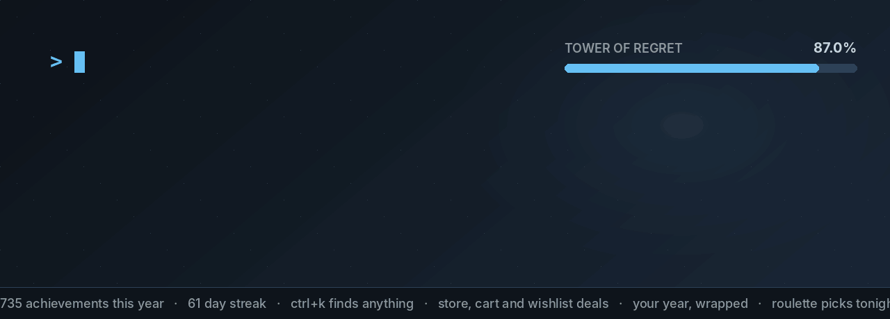
</p>

<p align="center">
  <a href="https://github.com/tomikav/steam-achievements-cli-/releases/latest"></a>
  <a href="https://github.com/tomikav/steam-achievements-cli-/actions/workflows/ci.yml"></a>
  
  
  <a href="LICENSE"></a>
</p>

<p align="center">
  <a href="#install"><b>Install</b></a> &nbsp;&middot;&nbsp;
  <a href="#try-it-in-10-seconds"><b>Try the demo</b></a> &nbsp;&middot;&nbsp;
  <a href="#why-not-just-open-steam">Why</a> &nbsp;&middot;&nbsp;
  <a href="#what-you-get">What you get</a> &nbsp;&middot;&nbsp;
  <a href="#keys">Keys</a> &nbsp;&middot;&nbsp;
  <a href="#something-not-working">Help</a>
</p>

<br>

**steam** is your Steam library in the terminal. Every achievement with its
real icon and rarity, the store with a cart that remembers prices, your
profile, your friends, and your year on Steam, all one keystroke away. Games
launch with one key while the Steam window stays closed.

<p align="center">
  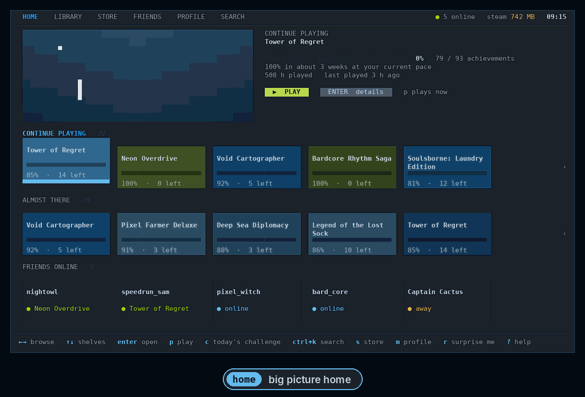
</p>

<sub>Everything above is the real app running on the built-in demo library, recorded frame by frame.</sub>

<br>

## Try it in 10 seconds

No account, no API key: the demo library shows every screen with fictional games.

```bash
steam --demo
```

Then press `ctrl+k` and type anything.

<br>

## Why not just open Steam?

| | Steam client | `steam` |
|:--|:--|:--|
| Memory | a full browser engine (steamwebhelper) | one small binary; the home screen shows both numbers live |
| Find anything | a different page for games, store and friends | `ctrl+k`: games, locked achievements, friends, store, themes and actions in one box |
| Start to your game | open the client, wait for the store page, find the game | `steam play elden` |
| Home | a launcher | a Big Picture style home in the terminal: hero art, PLAY button, shelves you move through with the arrows |
| Compare with a friend | open two profiles | `v` on a friend: games in common, hours side by side, who leads in each |
| A reason to play today | | a daily challenge picked from your locked achievements, and when each game hits 100% at your pace |
| Can't decide what to play | | `r` spins a roulette over your backlog and tells you why it picked that game |
| Easiest achievements you are missing | not available | `a` ranks every locked achievement of your library by how many players have it |
| Store | a web page inside the client | `s`: specials, top sellers, new, search, and a local cart that shows price drops |
| Your year | not available | `y` plays your year as slides and saves a share card |
| Disk space | one game at a time | `u` lists every library by size and flags what you have not played in 90 days |
| Close Steam and keep playing | | `x` twice closes the client; games still launch, Steam starts hidden |

<br>

## Install

<table>
<tr>
<td width="50%" valign="top">

**Windows** &nbsp;(PowerShell)

```powershell
irm https://raw.githubusercontent.com/tomikav/steam-achievements-cli-/main/install.ps1 | iex
```

</td>
<td width="50%" valign="top">

**macOS / Linux**

```bash
curl -fsSL https://raw.githubusercontent.com/tomikav/steam-achievements-cli-/main/install.sh | sh
```

</td>
</tr>
</table>

That is it: the script downloads the latest release, verifies its checksum and
adds `steam` to your PATH. No admin rights. Open a new terminal afterwards.

<details>
<summary>Other ways to install</summary>

<br>

With Go 1.26+:

```bash
go install github.com/tomikav/steam-achievements-cli-/cmd/steam@latest
```

Or download a zip from [Releases](https://github.com/tomikav/steam-achievements-cli-/releases/latest)
and put the binary anywhere on your PATH.

On Linux the installer names the command `steam-ach` so it does not clash with
the Steam client. Set `BIN_NAME=steam` before running it to change that.

</details>

<br>

## Set up in 3 steps

**1 &nbsp;Get a free API key** at [steamcommunity.com/dev/apikey](https://steamcommunity.com/dev/apikey).
Any domain works in the form, `localhost` is fine.

**2 &nbsp;Save it with your Steam ID** (the 17-digit number from [steamid.io](https://steamid.io),
or your custom profile name):

```bash
steam config set key YOUR_API_KEY
steam config set id  YOUR_STEAM_ID
```

**3 &nbsp;Make your game details public** in
[Steam › Edit Profile › Privacy Settings](https://steamcommunity.com/my/edit/settings):

| Setting | Set to | Needed for |
|:--|:--|:--|
| My profile | **Public** | everything |
| Game details | **Public** | your games and achievements |
| Friends List | **Public** | the friends view (optional) |

> "Friends only" is not enough. The API key does not sign in as you, so Steam
> treats it like a visitor. Changes can take a few minutes to apply.

Then check and go:

```bash
steam doctor   # tells you if anything is missing
steam          # opens the app
```

<br>

## What you get

### Home, Big Picture style

The first screen works like Steam's Big Picture mode, in a terminal. A top
bar with the sections, friends online, the Steam client's memory and the
clock. A big hero for the focused game with its art, progress, when you will
hit 100% at your current pace, and a PLAY button. Under it, shelves of tiles:
continue playing, almost there, friends online. Arrows move like a
controller, `enter` opens, `p` plays, `↑` from the first shelf reaches the
top bar.

Every day it also picks **today's challenge**: one locked achievement that
10 to 80% of players have, in a game you already play. `c` takes you there.

<p align="center">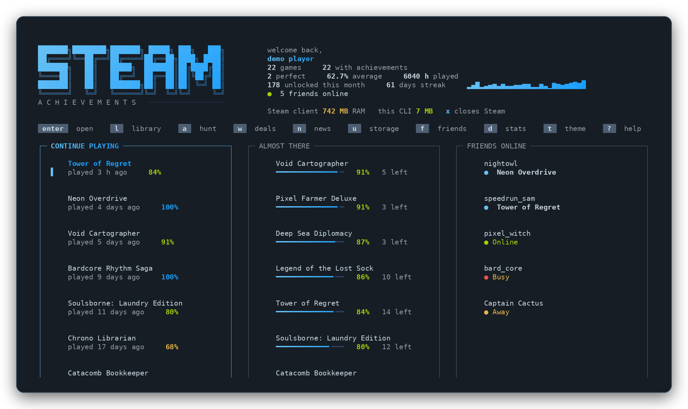</p>

### Search everything &nbsp;`ctrl+k`

One box for the whole app. Type a few letters of a game, a locked
achievement, a friend or a theme and press `enter`. A verb in front does the
action directly:

| You type | It does |
|:--|:--|
| `tower` | opens Tower of Regret |
| `play hades` | launches Hades |
| `store hollow knight` | searches the Steam store |
| `theme aurora` | switches the colours |
| `hk` | fuzzy: finds Hollow Knight |

<p align="center">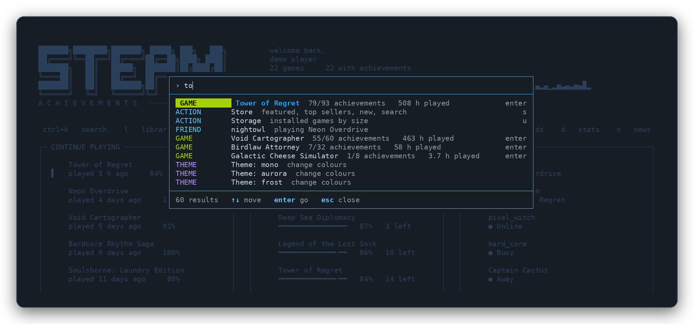</p>

### Store &nbsp;`s`

Specials, top sellers, new releases, coming soon and search, with the price
in your region and the store page beside the list. `c` keeps a game in a
local cart that remembers what it cost when you added it, so price drops show
up on their own. `b` opens the game inside Steam to buy it, `i` installs free
games. The app never asks for or handles payment details: checkout always
happens in Steam.

<p align="center">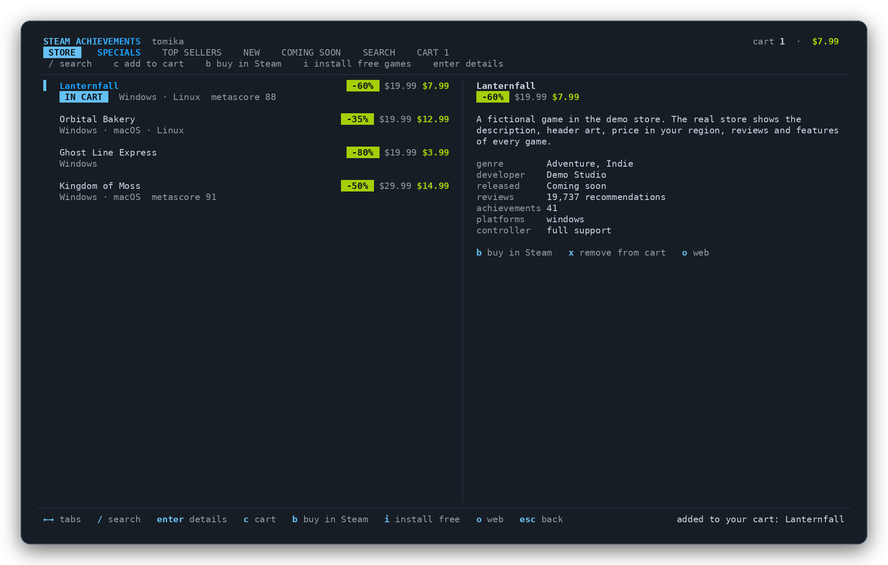</p>

### Profile &nbsp;`m`

Your name in big pixel letters, your Steam level in its ring colour with the
XP left, years on Steam, the library in numbers, what you played these two
weeks and a showcase of your rarest unlocked achievements.

<p align="center">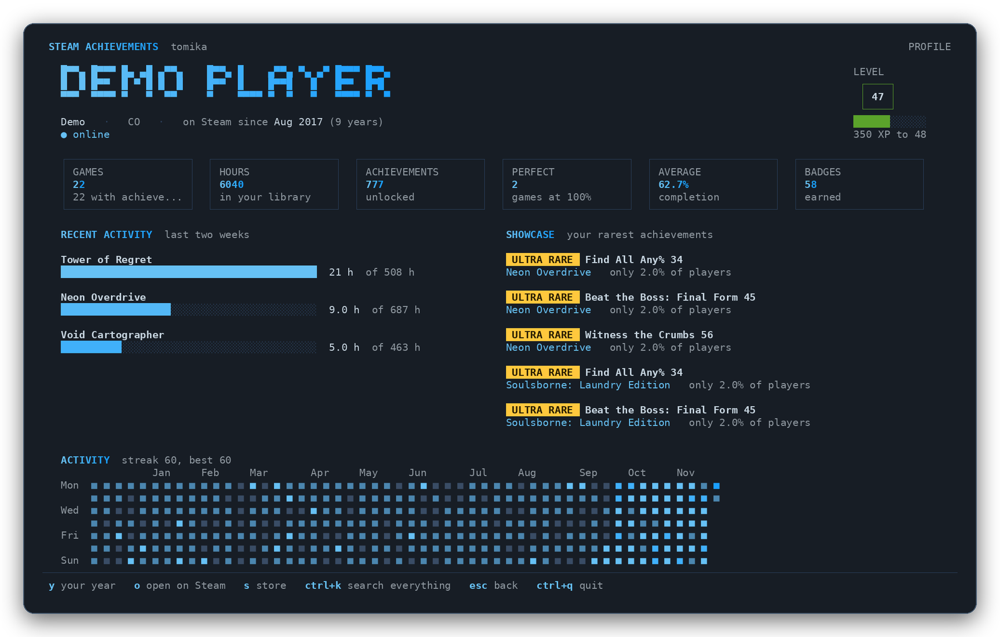</p>

### Your year &nbsp;`m` then `y`

Open it from your profile, from `ctrl+k`, or with `steam wrapped`. Eight
animated slides: achievements unlocked, your biggest month and busiest
day, your game of the year, the kind of player you are (night owl, weekend
warrior, completionist...), your longest streak and your rarest unlock. `e`
saves a share card like this one:

<p align="center">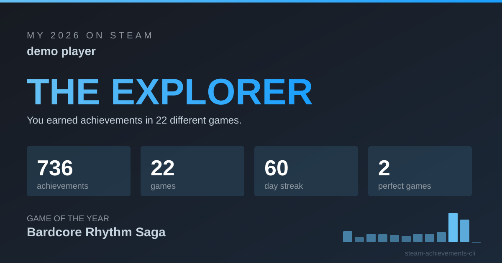</p>

```bash
steam wrapped --svg my-year.svg     # the same card, from a script
```

### Versus &nbsp;`v` on a friend

You and a friend side by side: every game you both own, sorted by hours,
with mirrored bars and each one's achievement progress. The winner of each
game is highlighted and the score is on top. Works with any friend whose
game details are public.

<p align="center">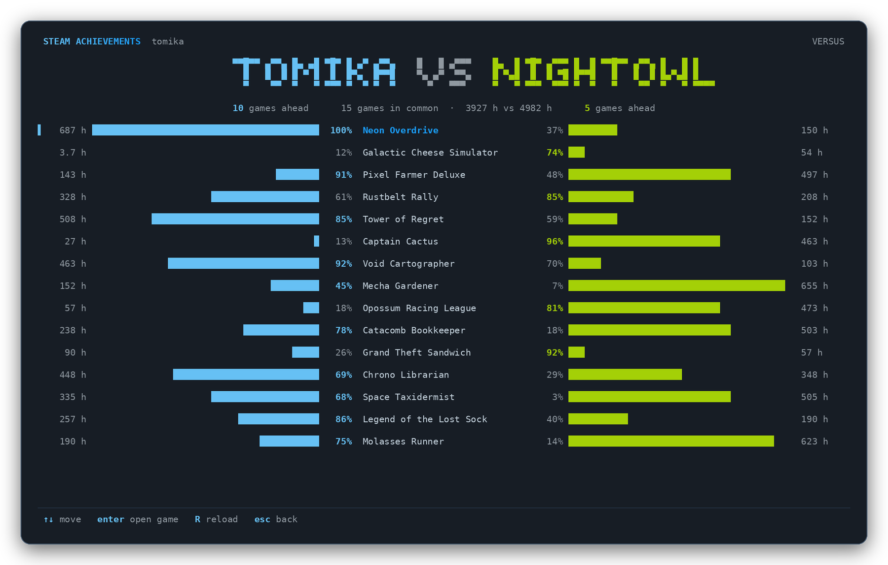</p>

### Surprise me &nbsp;`r`

A slot reel spins through your unfinished games and stops on one, weighted
towards games you are close to finishing and have not touched lately. It
tells you how far along you are and the easiest achievement left.

<p align="center">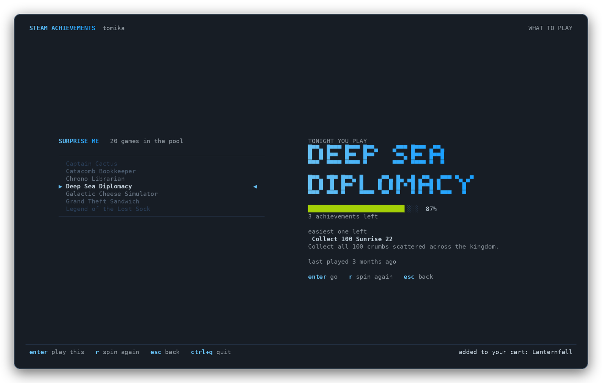</p>

### Game view

Everything about one game: store description, developer, genres, Metacritic
score, install size, your progress and the full achievement list. Unlocked
achievements show in colour, framed in gold when fewer than 5% of players have
them; locked ones are greyed out. Pick one to read its description and when
you unlocked it.

**Play from here.** `p` launches the game, `c` twice closes it. While it runs,
a session clock ticks and achievements refresh every 45 seconds, so new
unlocks pop up as they happen.

<p align="center">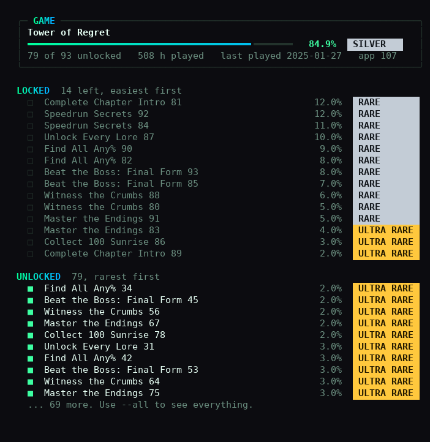</p>

<table>
<tr>
<td width="50%" valign="top">

**Library**<br>
Every game you own, with or without achievements. Tabs for in progress,
almost there, perfect and not started. Live search with `/`.

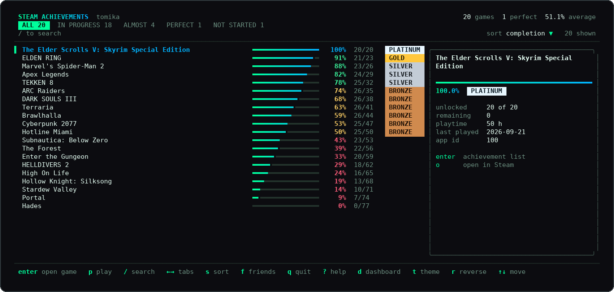

</td>
<td width="50%" valign="top">

**Achievements**<br>
The full list: locked ones easiest first, unlocked ones rarest first,
with global unlock rates and rarity labels.

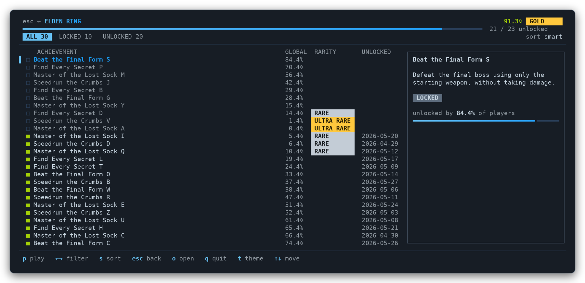

</td>
</tr>
<tr>
<td width="50%" valign="top">

**Friends**<br>
Who is online, who is away and what everyone is playing. `enter` opens
their profile.

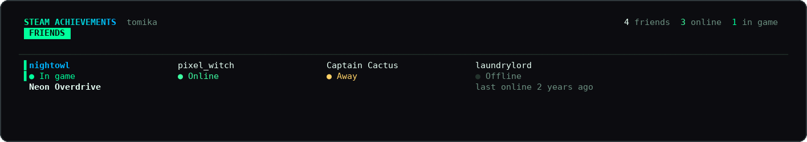

</td>
<td width="50%" valign="top">

**Stats**<br>
Totals, average completion, a chart of your library by completion and the
games you are closest to finishing.

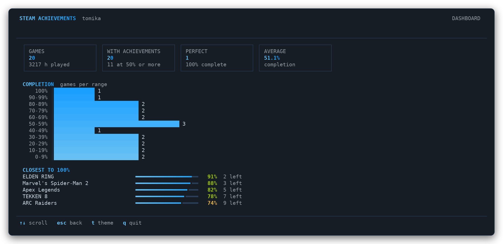

</td>
</tr>
</table>

### Achievement hunt

Every locked achievement in your library in one list, ordered by how many
players have it. The top of the list is the easiest progress you can make
tonight. `→` flips it to rarest first, `enter` opens the game.

<p align="center">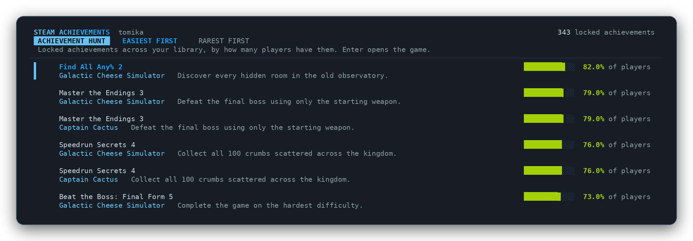</p>

### Activity and charts

The stats screen (`d`) draws your whole library: one bar split by state, a
year of unlocks with one square per day and your streaks, unlocks per month
and per weekday, where your hours went, and games per completion range. The
home screen keeps the month count, the streak and a 4-week sparkline in view.

<p align="center">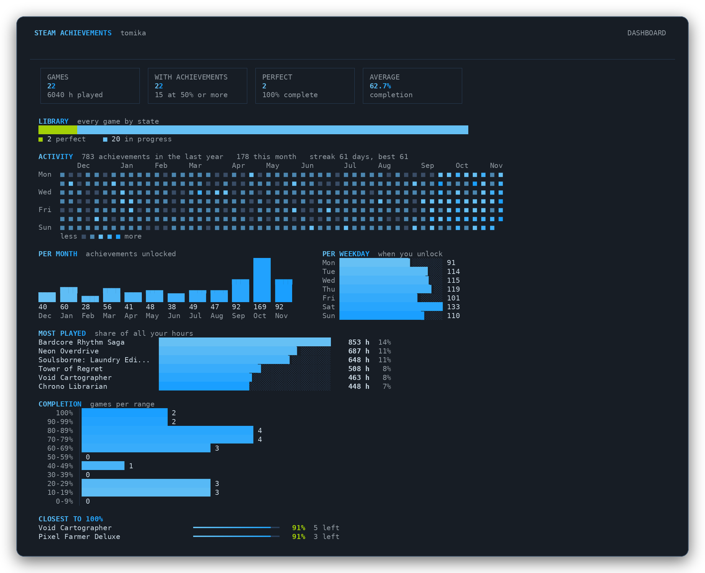</p>

### Motion

Views ease in when they open: bars grow, numbers count up, the heatmap sweeps
in from the left and the banner gets a slow highlight. Only the rows that
change are redrawn, so it stays light. Set `STEAM_NO_MOTION=1` to turn it off.

<table>
<tr>
<td width="50%" valign="top">

**Deals** &nbsp;`w`<br>
Your wishlist with today's price in your region, discounts first, plus the
store's current specials for games you do not own yet.

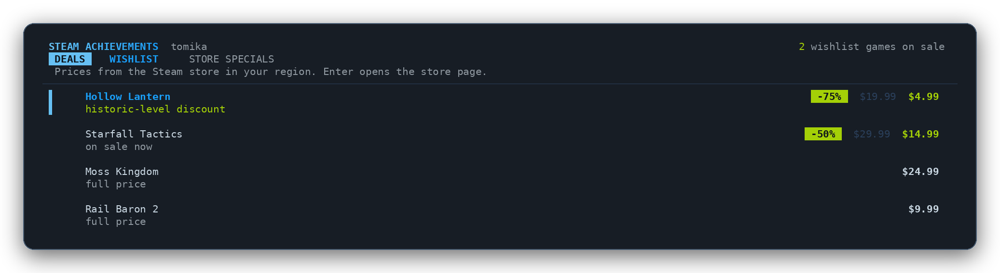

</td>
<td width="50%" valign="top">

**Storage** &nbsp;`u`<br>
Every installed game across all Steam libraries, biggest first, with the ones
you have not touched in 90 days in yellow. `u` twice hands the uninstall to Steam.

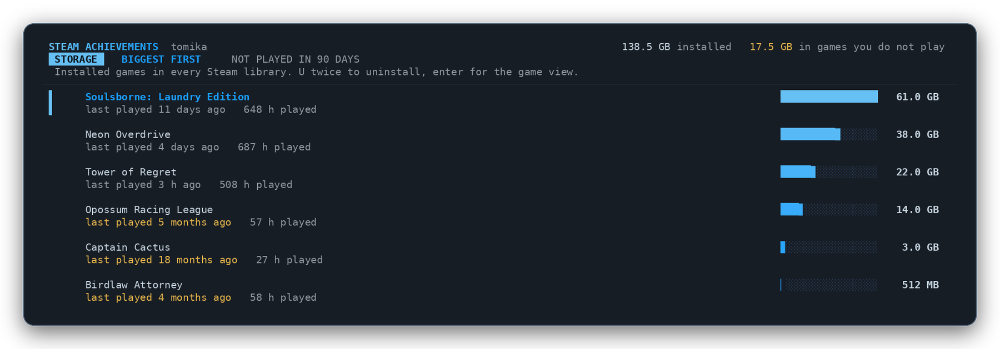

</td>
</tr>
</table>

**News** &nbsp;`n` &nbsp;Patch notes and announcements of the ten games you played last, newest first.

### Steam stays in the background

The app reads everything from Steam's web API, so the Steam window never has
to be open. When you launch a game, Steam is started hidden in the tray if it
is not running yet, and the game opens directly.

On the home screen you see how much memory the Steam client is using next to
this app. Press `x` twice to close the client; launching a game from here
brings it back silently.

### Icons in your terminal

Game icons, achievement icons, avatars and header art are drawn as real images
in terminals that support them: **Windows Terminal 1.22+**, WezTerm, iTerm2
3.5+, foot. In other terminals everything works, just without pictures.

### Themes

`steam` (default, Steam's own blue and grey) &nbsp;·&nbsp; `aurora` &nbsp;·&nbsp; `hacker` &nbsp;·&nbsp; `gamer` &nbsp;·&nbsp;
`synthwave` &nbsp;·&nbsp; `sunset` &nbsp;·&nbsp; `frost` &nbsp;·&nbsp; `mono`

Press `t` inside the app to cycle through them, or keep one:

```bash
steam config set theme aurora
```

<p align="center">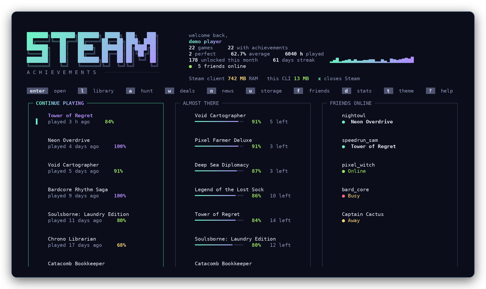</p>

<br>

## Keys

| Key | Home / Library | Game view |
|:--:|:--|:--|
| `↑` `↓` `←` `→` | move, switch cards or tabs | browse achievements, filter |
| `enter` | open | full-screen achievement list |
| `p` | open game and play | launch the game |
| `c` `c` | | close the game |
| `/` | search the library | |
| `s` &nbsp;`r` | sort, reverse | sort |
| `l` &nbsp;`f` &nbsp;`d` | library, friends, stats | |
| `a` &nbsp;`w` &nbsp;`n` &nbsp;`u` | hunt, deals, news, storage | |
| `x` `x` | close the Steam client (home) | |
| `ctrl+k` &nbsp;`:` | search everything | search everything |
| `s` &nbsp;`m` &nbsp;`r` | store, profile, roulette (home) | |
| `c` | today's challenge (home) | |
| `v` | compare with the selected friend (friends) | |
| `ctrl+q` | quit from anywhere, even while typing | quit |
| `o` | achievement page in browser | store page |
| `t` | change theme | change theme |
| `?` | every key | every key |
| `esc` &nbsp;`q` | back, quit | back, quit |

In the store: `←` `→` tabs, `/` search, `c` / `x` cart, `b` buy in Steam,
`i` install free games, `o` web page. In your year: `→` next, `e` save the card.
Mouse wheel and clicks work too.

<br>

## For scripts

Every view has a plain command, and `--format json` or `--format plain` for
piping:

```bash
steam list --min 90                   # games at 90% or more
steam list --sort playtime --top 10   # where your hours went
steam perfect                         # only 100% games
steam game "elden ring"               # one game's checklist
steam store hollow knight             # open the store on a search
steam profile                         # your profile
steam wrapped --svg year.svg          # your year, as a share card
steam surprise                        # let the roulette pick
steam play "elden ring"               # launch it, Steam stays hidden
steam stats                           # library dashboard
steam list --format json | jq '.[0]'
```

Add `--demo` to any command to try it with made-up data, no account needed.

<br>

## Something not working?

Run `steam doctor` first. It checks your key, your Steam ID and every privacy
setting, and tells you exactly what to change.

| You see | Do this |
|:--|:--|
| `Steam rejected your API key` | Create a new key and run `steam config set key ...`. A `STEAM_API_KEY` environment variable overrides the saved key. |
| `Your game details are private` | Set Game details to Public (step 3) and wait a few minutes. |
| `your friends list is private` | Set Friends List to Public, then press `R` in the friends view. |
| One game skipped with HTTP 500 | Steam fails for that game; it is retried the next day. |
| No pictures | Your terminal has no image support. Press `i` to hide the empty space. |

<br>

## Privacy

Read-only: the app never changes anything on your account. Uninstalling and
closing Steam are always handed to the Steam client and need two key presses.
Buying always happens in Steam: the app opens the game's page there and never
sees prices you pay, cards or passwords. The cart lives in a file on your PC. Your key is stored
in a file only your user can read and is sent only to Steam. Results are
cached on your machine so later runs open instantly. No telemetry.

<br>

## Build from source

```bash
git clone https://github.com/tomikav/steam-achievements-cli-.git
cd steam-achievements-cli-
go build -o steam ./cmd/steam
go test ./...
```

<br>

<p align="center">
  <sub>MIT licensed &nbsp;·&nbsp; not affiliated with Valve or Steam</sub>
</p>

<br>

<sub>steam-achievements-cli is a community project and is not affiliated with, endorsed or sponsored by Valve Corporation. Steam and the Steam logo are trademarks of Valve Corporation. All data comes from Steam's public Web API and store.</sub>
